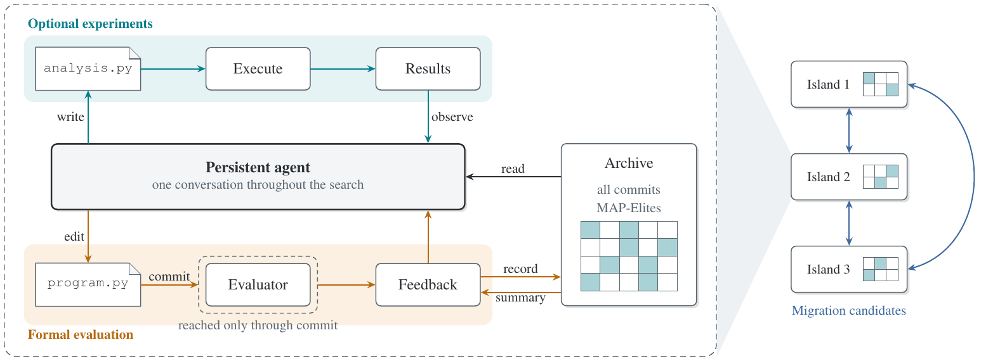

# AgenticEvolve

Evolutionary program search with persistent LLM agents.

Paper: [arXiv:2610.31326](https://arxiv.org/abs/2610.31326)



Each island is run by one LLM session that persists for the whole search. Between commits, the agent can run its own analysis scripts; only committed programs are formally evaluated. Every commit is recorded in an archive with a MAP-Elites grid per island, and islands receive elites from their ring neighbors through migration.

## Installation

Python 3.12+ and `uv`.

```bash
uv sync
```

## Quick start

```bash
export DEEPSEEK_API_KEY=...
uv run agentic-evolve examples/online_bin_packing/config.yaml
```

`--override` merges a second YAML file over the config: dictionaries merge, other values replace.

```bash
uv run agentic-evolve examples/online_bin_packing/config.yaml --override override.yaml
```

Settings and defaults: [CONFIG.md](CONFIG.md).

## Examples

| Example | Task |
|---|---|
| [circle_packing](examples/circle_packing) | 26 circles in the unit square, maximizing the sum of radii. The minimal task directory. |
| [online_bin_packing](examples/online_bin_packing) | A priority rule for online bin packing, in FunSearch's setting. |
| [dynamic_job_shop](examples/dynamic_job_shop) | A dispatching rule for a dynamic job shop, against a published rule. |
| [symbolic_regression](examples/symbolic_regression) | The equation behind an oscillator's data, under the LLM-SRBench protocol. |

## Defining a task

```
config.yaml         description, paths, settings
initial_program.py  starting program.py
evaluator.py        evaluate(program_path) -> dict with the fitness field and
                    the feature fields, each feature in [0, 1]
resources/          optional public data, solver code, and notes
openevolve.yaml     optional OpenEvolve settings for the comparison driver
```

`task.description` defines the task: state the function interface, execution rules, evaluation protocol, and meaning of each metric. Use `task.resources` for public files. They are listed in the system prompt, available through the `read` tool, and copied into each analysis and evaluation directory. The candidate program can import Python modules from `resources/`. The original files are read-only; changes to execution copies are discarded after each execution.

Keep private evaluator inputs, such as hidden instances and reference values, beside the evaluator and outside the resources directory.

## Run directory

```
runs/<timestamp>/
  config.yaml    effective config
  task/          snapshot of the task directory
  initial.json   evaluation of the initial program
  archive.jsonl  every commit, code inlined
  best.py        global best program
  best.json      its id, metrics, description
  sessions/      model conversations, one directory per island
  run.log
```

Runs store token counts. Cost is estimated at plot time from the mycode model catalog.

## Notes

- OS sandboxing uses the built-in `sandbox-exec` on macOS and requires `bubblewrap` with unprivileged user namespaces on Linux. Windows runs without an OS sandbox. See [CONFIG.md](CONFIG.md) for sandbox settings.
- For the paper's experiment matrices and baseline runners, see [experiments/README.md](experiments/README.md).

## Citation

The experiments in the paper used tags `v0.1.0` to `v0.2.1`. Their source and run records are archived on [Zenodo](https://doi.org/10.5281/zenodo.23561528).

```bibtex
@misc{peng2026agenticevolve,
  title         = {AgenticEvolve: Evolutionary Program Search with Persistent Language Model Agents that Design and Run Experiments},
  author        = {Peng, Ze-Yu and Lan, Qing-Yu and Wang, Zhan-He and Zhang, Jun and Piao, Yun-Song},
  year          = {2026},
  eprint        = {2610.31326},
  archivePrefix = {arXiv},
  primaryClass  = {cs.NE},
}
```

## License

MIT. See [LICENSE](LICENSE).

## Development

```bash
uv run ruff format .
uv run ruff check .
uv run ty check
uv run pytest
```
